# Claude Code reliability reading: diagram sources

Accessed: 2026-10-27 (Asia/Shanghai).

Repository: https://github.com/Windy3f3f3f3f/how-claude-code-works

Pinned commit: f4d6505ed9162a0ee6be089190f74c419ecacb19.

The first ten diagrams are unchanged Mermaid blocks from the independent analysis repository, not official Anthropic diagrams. Rendering changes layout only. Historical implementation claims in the diagrams are qualified in the article. The last four diagrams are editorial synthesis, not repository originals. PNG masters are rendered on white with PingFang SC; the site pipeline generates responsive WebP. No contributor photographs or QR codes are reused.

## claude-code-repo01-agent-loop

Source: [02-agent-loop.md](https://github.com/Windy3f3f3f3f/how-claude-code-works/blob/f4d6505ed9162a0ee6be089190f74c419ecacb19/docs/02-agent-loop.md), 2.2 双层生成器架构. License: MIT.

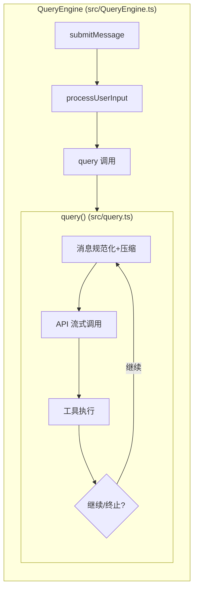

## claude-code-repo02-context-construction

Source: [03-context-engineering.md](https://github.com/Windy3f3f3f3f/how-claude-code-works/blob/f4d6505ed9162a0ee6be089190f74c419ecacb19/docs/03-context-engineering.md), 3.1 上下文构建全景. License: MIT.

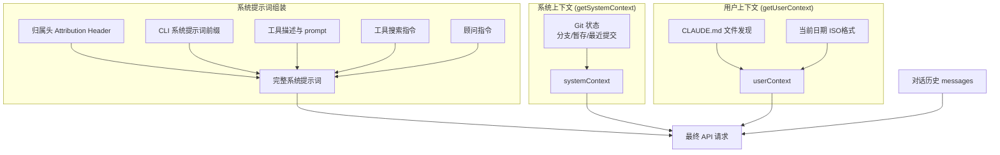

## claude-code-repo03-compaction-pipeline

Source: [03-context-engineering.md](https://github.com/Windy3f3f3f3f/how-claude-code-works/blob/f4d6505ed9162a0ee6be089190f74c419ecacb19/docs/03-context-engineering.md), 3.4 五级压缩流水线. License: MIT.

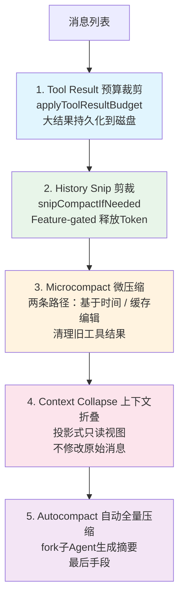

## claude-code-repo04-tool-lifecycle

Source: [04-tool-system.md](https://github.com/Windy3f3f3f3f/how-claude-code-works/blob/f4d6505ed9162a0ee6be089190f74c419ecacb19/docs/04-tool-system.md), 4.4 工具执行生命周期. License: MIT.

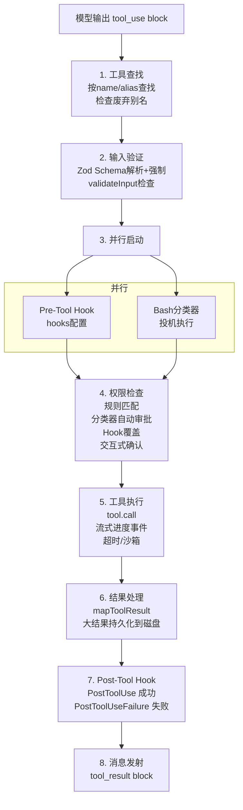

## claude-code-repo05-edit-tool-integration

Source: [05-code-editing-strategy.md](https://github.com/Windy3f3f3f3f/how-claude-code-works/blob/f4d6505ed9162a0ee6be089190f74c419ecacb19/docs/05-code-editing-strategy.md), 10.10 与工具系统的整合. License: MIT.

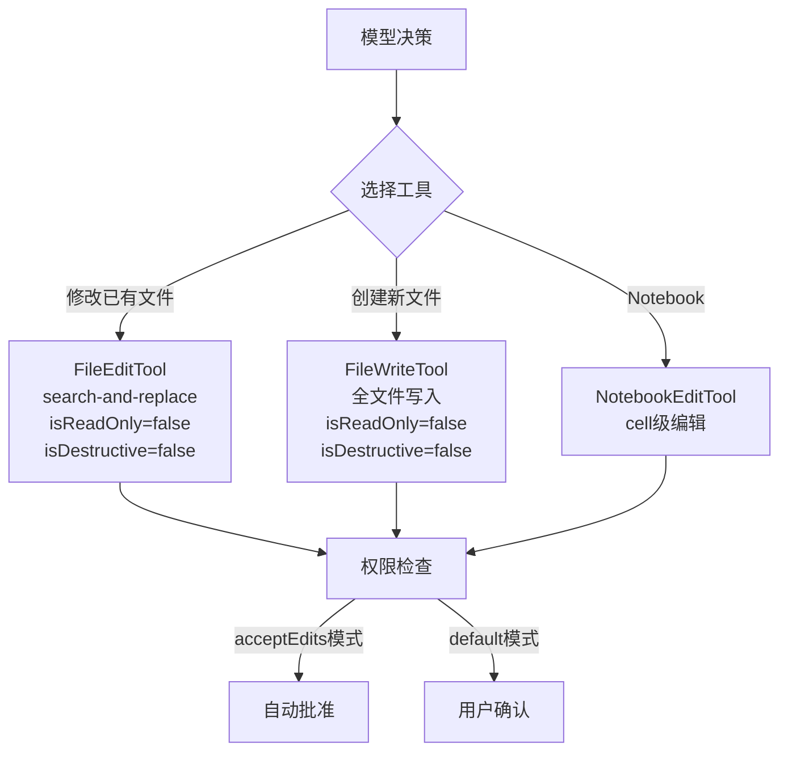

## claude-code-repo06-hook-engine

Source: [06-hooks-extensibility.md](https://github.com/Windy3f3f3f3f/how-claude-code-works/blob/f4d6505ed9162a0ee6be089190f74c419ecacb19/docs/06-hooks-extensibility.md), 7.4 Hook 执行引擎. License: MIT.

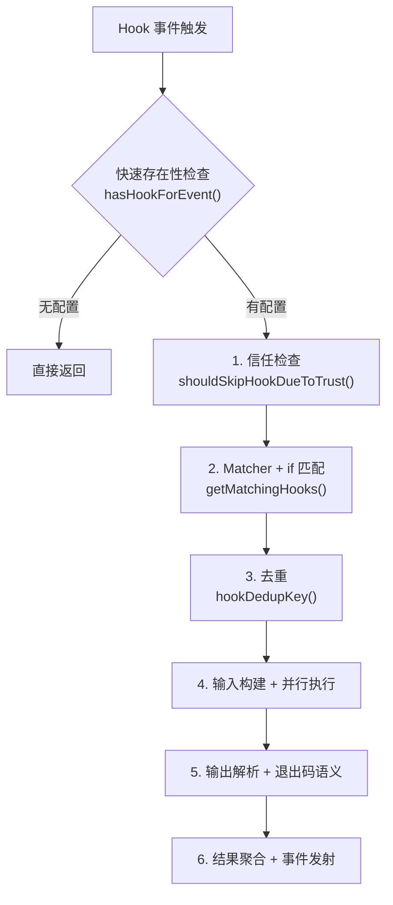

## claude-code-repo07-subagent-context

Source: [07-multi-agent.md](https://github.com/Windy3f3f3f3f/how-claude-code-works/blob/f4d6505ed9162a0ee6be089190f74c419ecacb19/docs/07-multi-agent.md), 上下文隔离深度解析. License: MIT.

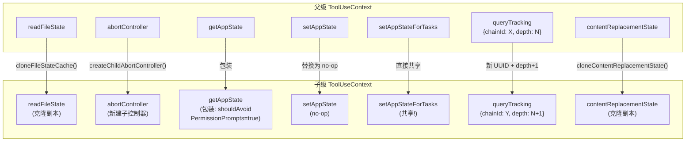

## claude-code-repo08-memory-decision

Source: [08-memory-system.md](https://github.com/Windy3f3f3f3f/how-claude-code-works/blob/f4d6505ed9162a0ee6be089190f74c419ecacb19/docs/08-memory-system.md), 记忆决策流程. License: MIT.

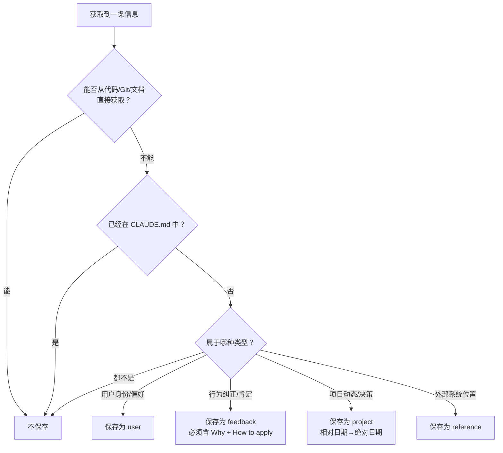

## claude-code-repo09-skill-execution

Source: [09-skills-system.md](https://github.com/Windy3f3f3f3f/how-claude-code-works/blob/f4d6505ed9162a0ee6be089190f74c419ecacb19/docs/09-skills-system.md), 执行流程概览. License: MIT.

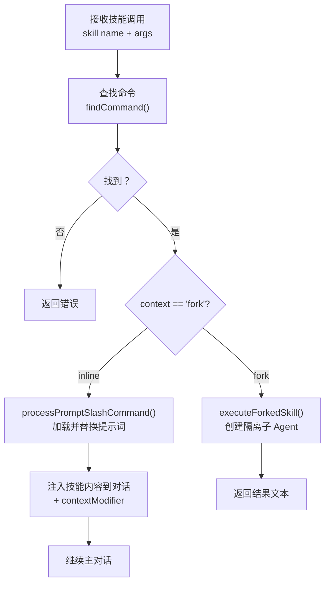

## claude-code-repo10-plan-sequence

Source: [10-plan-mode.md](https://github.com/Windy3f3f3f3f/how-claude-code-works/blob/f4d6505ed9162a0ee6be089190f74c419ecacb19/docs/10-plan-mode.md), 9.2 全景：一次完整的 Plan 模式流程. License: MIT.

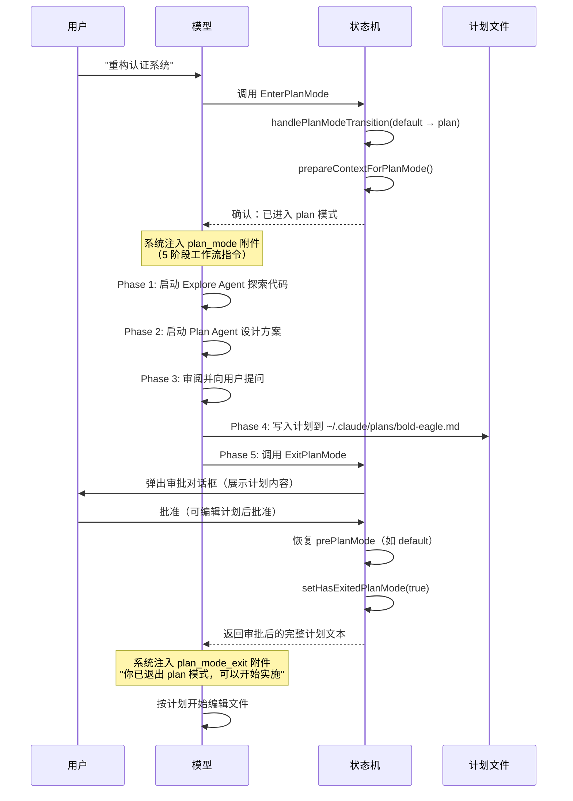

## claude-code-analysis01-reliability-layers

Source: original editorial synthesis for this report, 2026-10-27. This is not an Anthropic implementation diagram.

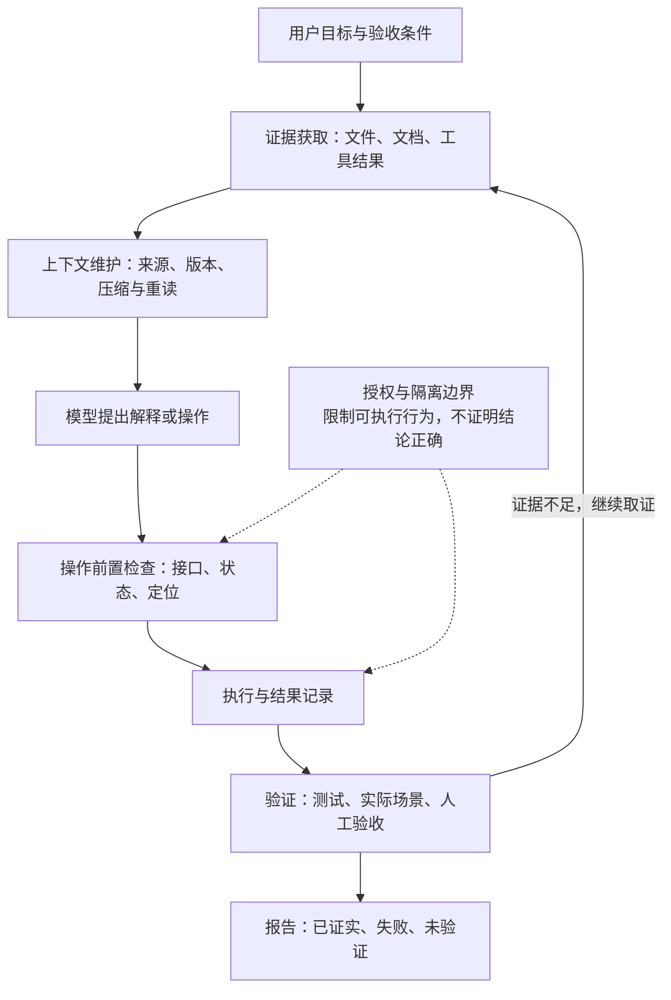

## claude-code-analysis02-read-edit-freshness

Source: original editorial synthesis. The content-fingerprint contract illustrates a stronger engineering design; it is not a claim about Claude Code's exact filesystem implementation.

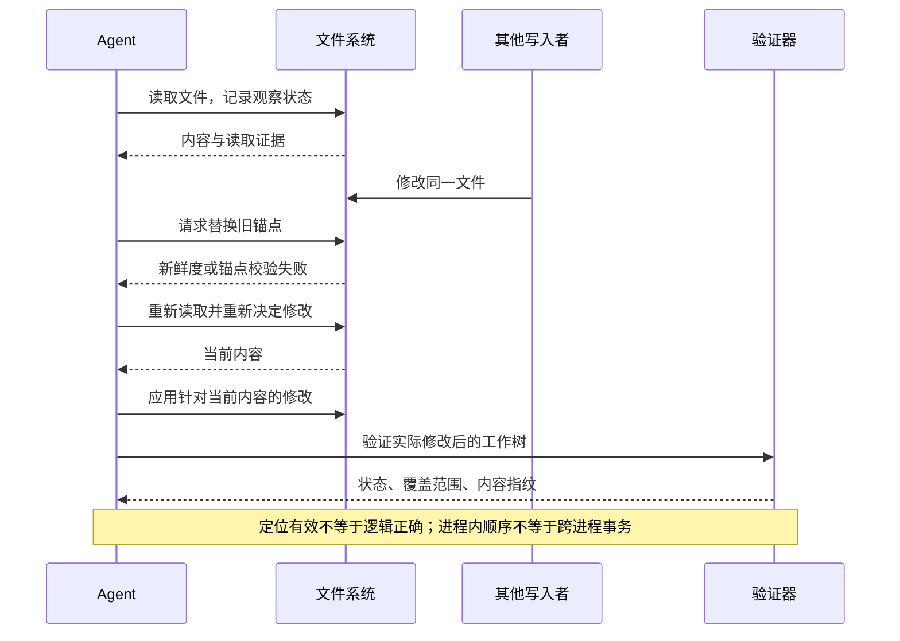

## claude-code-analysis03-evidence-loss-and-recovery

Source: original editorial synthesis. The examples illustrate failure modes, not recorded product incidents.

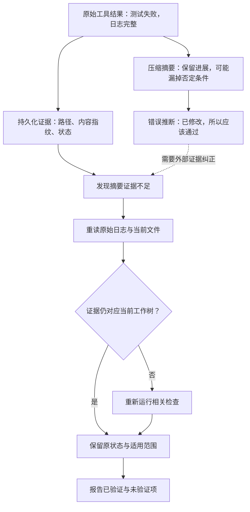

## claude-code-analysis04-completion-evidence

Source: original editorial synthesis of a completion contract, not a built-in Claude Code state machine.

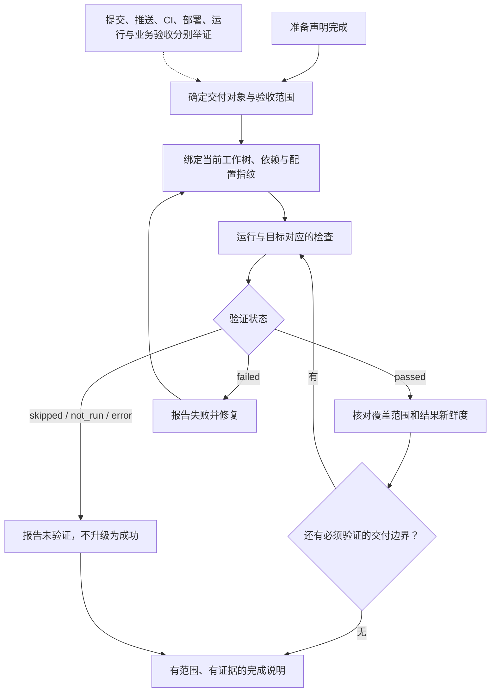

## Repository license

The MIT notice below applies to the cited repository material. It does not relicense Anthropic software, proprietary prompt text, trademarks, or official documentation. The report paraphrases implementation descriptions rather than redistributing full internal prompt collections.

```text
MIT License

Copyright (c) 2025 Windy3f3f3f3f

Permission is hereby granted, free of charge, to any person obtaining a copy
of this software and associated documentation files (the "Software"), to deal
in the Software without restriction, including without limitation the rights
to use, copy, modify, merge, publish, distribute, sublicense, and/or sell
copies of the Software, and to permit persons to whom the Software is
furnished to do so, subject to the following conditions:

The above copyright notice and this permission notice shall be included in all
copies or substantial portions of the Software.

THE SOFTWARE IS PROVIDED "AS IS", WITHOUT WARRANTY OF ANY KIND, EXPRESS OR
IMPLIED, INCLUDING BUT NOT LIMITED TO THE WARRANTIES OF MERCHANTABILITY,
FITNESS FOR A PARTICULAR PURPOSE AND NONINFRINGEMENT. IN NO EVENT SHALL THE
AUTHORS OR COPYRIGHT HOLDERS BE LIABLE FOR ANY CLAIM, DAMAGES OR OTHER
LIABILITY, WHETHER IN AN ACTION OF CONTRACT, TORT OR OTHERWISE, ARISING FROM,
OUT OF OR IN CONNECTION WITH THE SOFTWARE OR THE USE OR OTHER DEALINGS IN THE
SOFTWARE.
```
